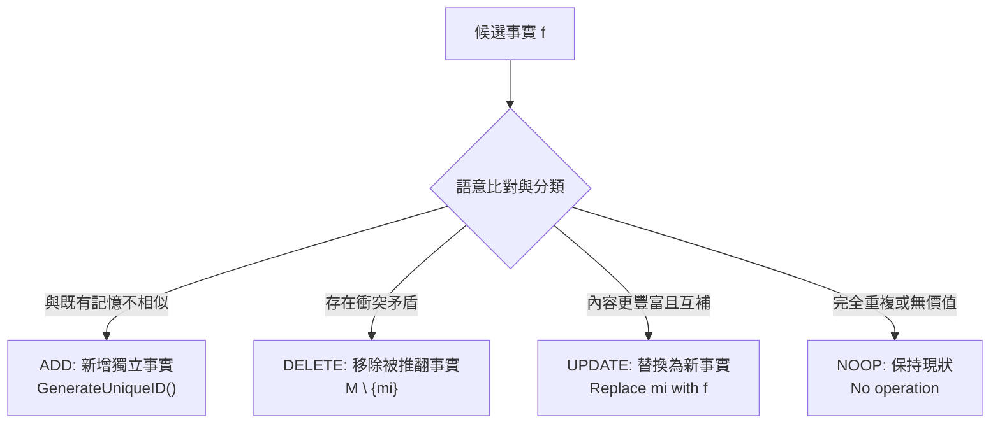

# 動態記憶四態操作（ADD / UPDATE / DELETE / NOOP）

## 概念定義
動態記憶四態操作（Dynamic Memory Operations）指在對話記憶生命週期管理中，系統將新萃取的候選事實與既有記憶比對後，由 LLM 透過 Function Calling（Tool Call）主動執行的四種離散狀態轉移操作：新增（ADD）、更新（UPDATE）、刪除（DELETE）與無操作（NOOP）(來源: Mem0.pdf, Section 2.1/Page 4, Appendix B/Page 21)。

---

## 運作機制與演算法流程（Algorithm 1）

### 1. 檢索與比對
- 針對新萃取的候選事實 $f \in F$，系統首先透過稠密向量檢索，從既有記憶庫 $M$ 中取出前 $s$ 筆最相似的記憶片段（$s=10$）(來源: Mem0.pdf, Section 2.1/Page 4, 5)。
- 將這 $s$ 筆記憶與候選事實封裝為 Tool Call 提示詞傳入 LLM，不透過額外獨立分類器，而是直接利用 LLM 的語意理解進行關係判定 (來源: Mem0.pdf, Section 2.1/Page 4)。

### 2. 四大狀態轉移規則（Algorithm 1）
依據論文定義之演算法規則 (來源: Mem0.pdf, Appendix B/Page 21)：
1. **ADD（新增）**：
   - 觸發條件：`¬SemanticallySimilar(f, M)`（新資訊未曾出現在既有記憶中）。
   - 執行動作：生成唯一 ID，以 `(id, f, "ADD")` 寫入記憶庫 $M \leftarrow M \cup \{(id, f, \text{"ADD"})\}$ (來源: Mem0.pdf, Appendix B/Page 21)。
2. **UPDATE（更新增強）**：
   - 觸發條件：`Augments(f, M)` 且 `InformationContent(f) > InformationContent(mi)`（新事實為既有相似記憶 $m_i$ 提供更具體、完整的細節）。
   - 執行動作：保留原始 ID 或關聯鍵，將舊記憶替換為更豐富的事實 $M \leftarrow (M \setminus \{m_i\}) \cup \{(id_i, f, \text{"UPDATE"})\}$ (來源: Mem0.pdf, Appendix B/Page 21)。
3. **DELETE（刪除清理）**：
   - 觸發條件：`Contradicts(f, M)`（新事實與既有記憶 $m_i$ 發生邏輯矛盾，例如使用者聲明「搬家」或「改變飲食習慣」）。
   - 執行動作：自記憶庫中物理抹除舊矛盾事實 $M \leftarrow M \setminus \{m_i\}$ (來源: Mem0.pdf, Appendix B/Page 21)。
4. **NOOP（無操作）**：
   - 觸發條件：事實已完全包含於既有記憶庫中，或為無實質資訊價值的客套語。
   - 執行動作：不修改資料庫，節省寫入開銷 (來源: Mem0.pdf, Appendix B/Page 21)。

---

## 與傳統 Context / 靜態 RAG 之對比優勢
- **避免記憶庫無限線性膨脹**：傳統對話紀錄或單純 Append-only 向量資料庫無法清理舊資訊；四態操作能即時驅逐已過期或被推翻的陳述 (來源: Mem0.pdf, Section 1/Page 2, Section 2.1/Page 4)。
- **消除知識矛盾**：確保傳入推論模型的檢索上下文具備一致性，避免 LLM 在同一對話中接收到互相矛盾的資訊 (來源: Mem0.pdf, Section 2.1/Page 4)。

---

## 相關引用與頁面
- 出處論文：[[mem0]]
- 傳統限制：[[context_is_what_you_need]]
- 圖譜擴充：[[graph_memory_representations]]
- 系統對比：[[architecture_comparison]]
