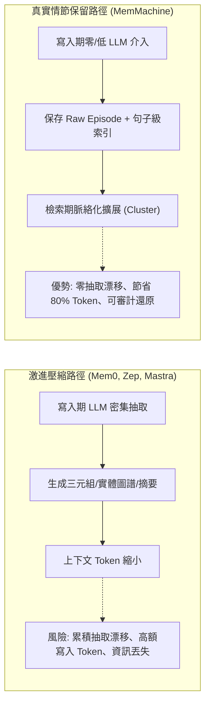

# 真實情節保留架構（Ground-Truth-Preserving Architecture）

## 概念定義
真實情節保留架構（Ground-Truth-Preserving Architecture）指在代理人記憶系統中，原汁原味地儲存原始對話情節（Raw Conversational Episodes），並僅採用輕量化的句子級切塊與向量索引，最大程度減少或免除常態性 LLM 實體/事實抽取與改寫的架構哲學 (來源: MemMachine.pdf, Abstract/Page 1, Section 1.1/Page 2)。

---

## 核心設計張力：壓縮（Compression）vs. 保留（Preservation）

在 AI 代理人記憶系統的演進中，存在著根本性的設計權衡 (來源: MemMachine.pdf, Section 2.2/Page 3, Section 9.8/Page 15, Table 16/Page 16)：

### 1. 激進壓縮路線的隱患
- 系統如 Mem0、Zep 與 Mastra 在寫入期對每則對話進行實體抽取、三元組構建或背景日誌壓縮 (來源: MemMachine.pdf, Section 2.2/Page 2-3)。
- **複合抽取漂移（Compounding Extraction Drift）**：依賴 LLM 的機率性抽取不可避免地會漏掉細節或產生幻覺，隨著多 Session 迭代，抽取錯誤會不斷累積與放大 (來源: MemMachine.pdf, Section 1/Page 2, Section 2.2/Page 2)。
- **寫入成本高昂**：對每則訊息進行 LLM 呼叫，佔據了整個記憶系統絕大部分的 Token 消耗 (來源: MemMachine.pdf, Section 6.1/Page 9)。

### 2. MemMachine 的真實保留機制
- **情節結構（Episode）**：對話直接以 Episode 形式持久化於資料庫，完整攜帶時間戳記、發話者（Producer）與會話識別碼（Session ID）(來源: MemMachine.pdf, Section 4.2/Page 4-5)。
- **句子級切塊（Sentence Chunking）**：使用 NLTK Punkt 分詞器將情節拆解為句子級細顆粒度進行向量嵌入，既能精準命中單句事實，又能在資料庫中保留與母情節的雙向關聯 (來源: MemMachine.pdf, Section 4.4/Page 5)。
- **慎用 LLM**：LLM 僅在會話溢出時進行 STM 摘要、或抽取個人畫像屬性時才被調用，日常記憶寫入完全零 LLM 負擔 (來源: MemMachine.pdf, Section 6.1/Page 9)。

---

## 實證結論：檢索階段優化主導最終準確率
LongMemEvalS（115,000 tokens）消融實驗揭示了一項關鍵的架構實證 (來源: MemMachine.pdf, Section 9.1/Page 13, Table 13/Page 13)：
- **檢索端累計效益**：檢索深度優化（$k: 20 \to 30$）貢獻 **+4.2%**、上下文斷行排版貢獻 **+2.0%**、搜尋提示詞設計貢獻 **+1.8%**、使用者前綴偏差修正貢獻 **+1.4%**。
- **寫入端切塊效益**：句子級切塊僅帶來 **+0.8%** 的微幅增益。
- **架構啟示**：只要儲存層完整保留了原始真實數據（Ground Truth），「資料如何在檢索期被精準召回與重排」，其重要性與工程回報遠大於「在寫入期耗費巨資進行複雜的圖譜抽取」 (來源: MemMachine.pdf, Section 9.1/Page 13)。

---

## 相關引用與頁面
- 出處論文：[[mem_machine]]
- 脈絡擴展：[[contextualized_retrieval]]
- 檢索代理人：[[late_binding_and_retrieval_agents]]
- 成本對比：[[memory_latency_cost_tradeoffs]]
- 跨架構綜合對照：[[architecture_comparison]]
