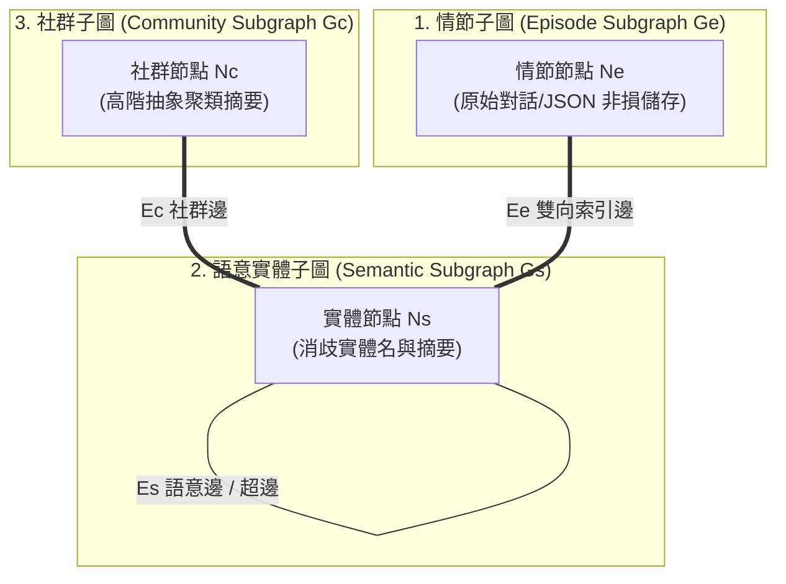

# 階層式記憶子圖與動態標籤傳播（Hierarchical Subgraphs & Dynamic Label Propagation）

## 概念定義
階層式記憶子圖（Hierarchical Memory Subgraphs）指將對話記憶依據抽象層級劃分為「情節子圖（Episode Subgraph）」、「語意實體子圖（Semantic Entity Subgraph）」與「社群子圖（Community Subgraph）」之三層知識架構；並透過「動態標籤傳播（Dynamic Label Propagation）」演算法在無需全量重新聚類的前提下實現社群的增量演化 (來源: ZEP.pdf, Section 2/Page 2, Section 2.3/Page 4)。

---

## 三層子圖拓撲結構：$\mathcal{G} = (\mathcal{N}, \mathcal{E}, \phi)$

1. **情節子圖（Episode Subgraph, $\mathcal{G}_e$）**：
   - **節點 $n_i \in \mathcal{N}_e$**：儲存未加工的原始對話輪次（Messages）、文字或 JSON，附帶發話者（actor）與時間戳記 $t_{\text{ref}}$ (來源: ZEP.pdf, Section 2.1/Page 2)。
   - **雙向索引邊 $e_i \in \mathcal{E}_e$**：情節節點與抽取之實體節點建立雙向索引。向前走訪可將語意實體溯源至對話原文以供引用（Citation），向後走訪可從情節快速提取對應的實體與事實 (來源: ZEP.pdf, Section 2.1/Page 3)。
2. **語意實體子圖（Semantic Entity Subgraph, $\mathcal{G}_s$）**：
   - **節點 $n_i \in \mathcal{N}_s$**：代表消歧後的實體，經由 1024 維向量與全文檢索雙路比對後合流 (來源: ZEP.pdf, Section 2.2.1/Page 3)。
   - **邊 $e_i \in \mathcal{E}_s$**：實體間關係與客觀事實。相同事實可建立於不同實體之間，以「超邊（Hyper-edges）」形式表徵複雜多實體關係 (來源: ZEP.pdf, Section 2.2.2/Page 3)。
3. **社群子圖（Community Subgraph, $\mathcal{G}_c$）**：
   - **節點 $n_i \in \mathcal{N}_c$**：代表強連通實體之高階社群聚類，內含 Map-Reduce 式生成的全局概括性摘要與社群命名 (來源: ZEP.pdf, Section 2/Page 2, Section 2.3/Page 4)。
   - **邊 $e_i \in \mathcal{E}_c$**：連結社群節點與其隸屬之實體成員 (來源: ZEP.pdf, Section 2/Page 2)。

---

## 認知心理學映射：情節記憶 vs. 語意記憶
雙層儲存原始情節數據與衍生語意實體的設計，直接呼應認知心理學對人類記憶的分類 (來源: ZEP.pdf, Section 2/Page 2)：
- **情節記憶（Episodic Memory）**：記錄帶有時間與地點背景的具體事件經歷（對應 $\mathcal{G}_e$）(來源: ZEP.pdf, Section 2/Page 2)。
- **語意記憶（Semantic Memory）**：記錄脫離情節背景的通用概念、事實與概念間的固定關聯（對應 $\mathcal{G}_s$ 與 $\mathcal{G}_c$）(來源: ZEP.pdf, Section 2/Page 2)。

---

## 動態標籤傳播（Dynamic Label Propagation）演算法
在社群偵測（Community Detection）中，Zep 選擇標籤傳播演算法而非 GraphRAG 採用的 Leiden 演算法，以實現高效增量寫入 (來源: ZEP.pdf, Section 2.3/Page 4)：
- **單步遞迴擴展機制**：當新實體節點 $n_i$ 寫入圖譜時，系統僅需調查其鄰近節點所屬的社群標籤，直接將該實體分配給鄰居中佔多數（Plurality）的社群，並就地更新該社群的摘要 (來源: ZEP.pdf, Section 2.3/Page 4)。
- **工程效益**：大幅延後全局圖譜重新計算的頻率，極大地降低了常態寫入時的延遲與 LLM 摘要推論成本（輔以背景定期全局刷新修正社群漂移）(來源: ZEP.pdf, Section 2.3/Page 4)。

---

## 相關引用與頁面
- 出處論文：[[zep]]
- 時間模型：[[temporal_knowledge_graphs]]
- 檢索機制：[[multi_faceted_graph_retrieval]]
- 圖譜架構對比：[[graph_memory_representations]]
- 跨架構綜合對比：[[architecture_comparison]]
