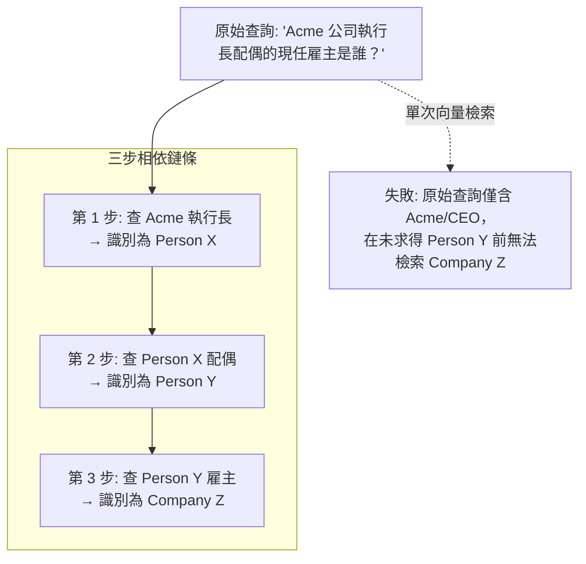
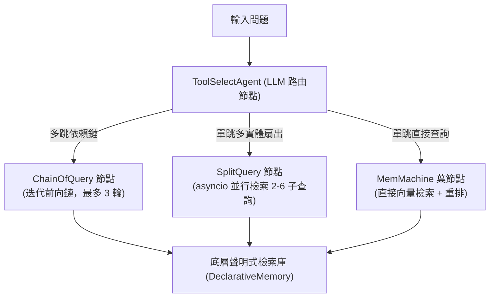

# 遲滯綁定難題與檢索代理人（Late Binding & Retrieval Agents）

## 概念定義
- **遲滯綁定難題（The Late Binding Problem）**：
  在多跳推理（Multi-Hop Reasoning）中，後續檢索步驟所需的關鍵實體或精確問題，在先前的檢索步驟尚未完成前是無法預先構建的；由於中介實體未知，任何單次單步（Single-Shot）向量檢索皆無法命中多跳依賴鏈後端的證據 (來源: MemMachine.pdf, Section 5/Page 6, Section 5.1/Page 6)。
- **檢索代理人（Retrieval Agent）**：
  MemMachine 提出的一套由 LLM 編排之工具樹（Tool Tree）檢索管線，能將輸入問題分類並路由至特定策略（直接檢索、並行拆解、迭代前向鏈），以有界運算成本（Bounded Cost）精準解決多跳遲滯綁定 (來源: MemMachine.pdf, Section 5/Page 6-7, Figure 3/Page 7)。

---

## 遲滯綁定實例與既有解法之侷限

- **單步檢索策略的無力**：查詢擴展（HyDE）、BM25 混合檢索或切塊重排皆無法解決依賴鏈，因其仍受困於單一查詢語句的語意空間 (來源: MemMachine.pdf, Section 5.1/Page 6)。
- **傳統圖譜遍歷的代價**：圖譜走訪固然能沿著節點邊走訪解決此問題，但必須在寫入期耗費巨額成本建立前置知識圖譜，對任意動態對話而言既昂貴且具資訊損耗 (來源: MemMachine.pdf, Section 5.1/Page 6)。

---

## 檢索代理人工具樹架構（Tool Tree）

MemMachine v0.3 設計了可組合的階層式工具樹 (來源: MemMachine.pdf, Section 5.2/Page 6-7, Figure 3/Page 7)：

### 1. 智慧查詢路由（ToolSelectAgent）
透過單次 LLM 呼叫，將問題嚴格歸類為三種結構類型之一 (來源: MemMachine.pdf, Section 5.3/Page 7)：
- **Multi-hop dependency chain**：若存在顯式依賴關係（即使涉及多實體），保守分發至 ChainOfQuery (來源: MemMachine.pdf, Section 5.3/Page 7)。
- **Single-hop multi-entity**：多個相互獨立實體之查詢，分發至 SplitQuery (來源: MemMachine.pdf, Section 5.3/Page 7)。
- **Single-hop direct**：單一實體事實檢索，直接路由至 MemMachine 葉節點，無額外分解成本 (來源: MemMachine.pdf, Section 5.3/Page 7)。

### 2. 三大路由策略執行細節
1. **ChainOfQuery（迭代依賴鏈積累）**：
   - 執行至多 3 輪迭代：(1) 依據當前問題檢索情節、(2) 單次 LLM 結合充分性判斷（Sufficiency Judgment）與基於檢索實體的事實改寫、(3) 證據累積 (來源: MemMachine.pdf, Section 5.4/Page 7)。
   - **提前終止機制**：信心度達到 $\ge 0.8$ 即停止，確保有界成本（上限 3 輪），徹底摒棄傳統開放式 Agent 循環（如 OpenAI Agents SDK max_turns=30）的 Token 失控風險 (來源: MemMachine.pdf, Section 5.4/Page 7, Section 5.7/Page 8)。
2. **SplitQuery（多實體並行扇出）**：
   - 單次 LLM 呼叫將問題拆解為 2~6 個獨立子查詢，透過 `asyncio.gather()` 並行執行檢索並匯總結果，禁止引入比較、排名等衍生運算，保持原子性 (來源: MemMachine.pdf, Section 5.4/Page 7)。
3. **MemMachine Direct（直接檢索）**：
   - 直接調用 `DeclarativeMemory.search_scored()`，作為最輕量級基底 (來源: MemMachine.pdf, Section 5.4/Page 7)。

---

## 離線提示詞優化（APO）與多查詢重排
- **自動提示詞優化（Auto Prompt Optimization, APO）**：
  採用 Agent Lightning 的微軟 APO 演算法進行離線 Prompt 調優，將終端答案 Prompt 準確度提升約 4%，所有 Agent Prompt 聯合調優提升約 **6%**；且調優全在離線完成，推論期零延遲與零額外 Token 開銷 (來源: MemMachine.pdf, Section 5.3/Page 7)。
- **多查詢重排（Multi-Query Reranking）**：
  重排器接收檢索歷程中產生的所有查詢字串串接，確保中間步驟提取的關鍵事實亦能獲得高分 (來源: MemMachine.pdf, Section 5.5/Page 7)。

---

## 實證數據表現
- **HotpotQA Hard 集**：Retrieval Agent 準確率達 **93.2%**，金標事實召回率達 **92.31%**（ChainOfQuery 在多跳橋接問題上召回率高達 **95.31%**）(來源: MemMachine.pdf, Section 5.6/Page 8, Table 4/Page 8)。
- **WikiMultiHop（混雜隨機雜訊情境）**：Retrieval Agent 準確率達到 **92.6%**（相較基準提升 5.2 個百分點）(來源: MemMachine.pdf, Section 5.6/Page 8, Table 3/Page 8)。
- **多輪代詞消歧（MRCR）**：準確率達到 **81.4%**（無記憶輔助之純模型僅 32.3%）(來源: MemMachine.pdf, Section 5.6/Page 8, Table 3/Page 8)。

---

## 相關引用與頁面
- 出處論文：[[mem_machine]]
- 情節保留哲學：[[ground_truth_preserving_architecture]]
- 脈絡擴展：[[contextualized_retrieval]]
- 成本延遲對比：[[memory_latency_cost_tradeoffs]]
- 綜合對比：[[architecture_comparison]]
