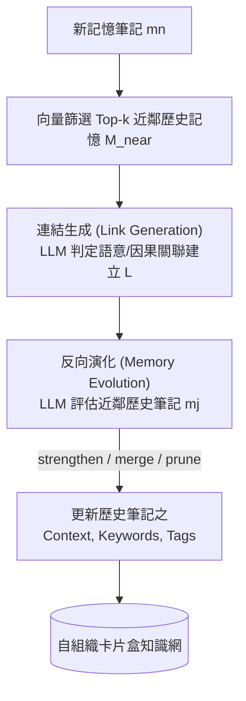

# 記憶連結生成與反向演化（Memory Linking & Evolution）

## 概念定義
記憶連結生成與反向演化（Memory Linking & Evolution）指在 AI 代理人寫入新經驗時，系統不僅單向建立新記憶與歷史記憶之間的關聯網絡（Link Generation），更能反向觸發對既有歷史筆記之上下文描述、關鍵詞與標籤的動態重構與精煉（Memory Evolution），使整體記憶庫隨經驗積累自主湧現高階結構的機制 (來源: A-Mem.pdf, Abstract/Page 1, Section 3.2-3.3/Page 4-5)。

---

## 運作流程與演算法

### 1. 自主連結生成（Link Generation, LG）
- 當構建完新筆記 $m_n$ 後，先計算其向量與歷史筆記之餘弦相似度：
  $$s_{n,j} = \frac{e_n \cdot e_j}{|e_n||e_j|}$$
  以高效率檢索出 Top-$k$ 個候選最相關近鄰記憶 $M_{\text{near}}^n$ (來源: A-Mem.pdf, Section 3.2/Page 4)。
- 將候選近鄰與新筆記交付 LLM（Prompt $P_{s2}$），超越純幾何相似度，深入識別細微的因果脈絡、邏輯推演與跨概念關聯，生成動態連結集 $L_i \leftarrow \text{LLM}(m_n \parallel M_{\text{near}}^n \parallel P_{s2})$ (來源: A-Mem.pdf, Section 3.2/Page 4, Appendix B.2/Page 19)。

### 2. 反向記憶演化（Memory Evolution, ME）
- 針對近鄰歷史記憶 $m_j \in M_{\text{near}}^n$，系統由 LLM（Prompt $P_{s3}$）審視新經驗 $m_n$ 對舊記憶理解帶來的改變：
  $$m_j^* \leftarrow \text{LLM}(m_n \parallel M_{\text{near}}^n \setminus \{m_j\} \parallel m_j \parallel P_{s3})$$
  (來源: A-Mem.pdf, Section 3.3/Page 4-5, Appendix B.3/Page 20)。
- **複合演化動作**：
  - **強化（Strengthen）**：加深相關主題之間的關聯權重與連結 (來源: A-Mem.pdf, Appendix B.3/Page 20)。
  - **合併（Merge）**：將碎片化或重疊的事實綜合為更具概括性的高階概念 (來源: A-Mem.pdf, Appendix B.3/Page 20)。
  - **修剪（Prune）**：剔除過期或無效的標籤與雜訊關聯 (來源: A-Mem.pdf, Appendix B.3/Page 20)。
- 演化後的筆記 $m_j^*$ 直接替換舊筆記，更新其 $X_j$（Context）、$K_j$（Keywords）與 $G_j$（Tags），模擬人類在獲取新知後重新審視與深化既有認知的學習過程 (來源: A-Mem.pdf, Section 3.3/Page 5)。

---

## 實證驗證與消融實驗

### 1. 消融實驗（Ablation Study on LoCoMo）
以 GPT-4o-mini 評測 LG 與 ME 模組之具體效益 (來源: A-Mem.pdf, Section 4.4/Page 7, Table 3/Page 7)：

| 配置 | Multi-Hop F1 | Temporal F1 | Open Domain F1 | Single Hop F1 |
| :--- | :--- | :--- | :--- | :--- |
| **無 LG 與 ME（w/o LG & ME）** | 9.65 | 24.55 | 7.77 | 13.28 |
| **僅具備連結生成（w/o ME）** | 21.35 | 31.24 | 10.13 | 39.17 |
| **完整 A-MEM（LG + ME）** | **27.02** | **45.85** | **12.14** | **44.65** |

- **關鍵結論**：
  - 缺乏連結生成與記憶演化時，多跳（Multi-Hop）推理 F1 暴跌近三分之二（27.02 $\to$ 9.65），證實動態網絡為跨輪次推理的核心基石 (來源: A-Mem.pdf, Section 4.4/Page 7)。
  - 記憶演化（ME）在 LG 基礎上進一步將 Multi-Hop F1 由 21.35 推升至 27.02，並將 Temporal F1 由 31.24 推升至 45.85，驗證了歷史記憶反向修飾對精確推理的不可替代性 (來源: A-Mem.pdf, Section 4.4/Page 7)。

### 2. t-SNE 空間分佈視覺化
- 在對話記憶向量降維分佈中，經過 LG 與 ME 持續演化的 A-Mem 記憶向量（藍點）呈現高度清晰、緊湊的語意群集（Coherent Clusters）；而未經演化的基準記憶（紅點）呈現雜亂分散狀態，實證了動態演化使記憶庫在幾何空間中自然形成自組織結構 (來源: A-Mem.pdf, Section 4.7/Page 9, Figure 4/Page 9, Figure 5/Page 18)。

---

## 與 Mem0 狀態操作之架構哲學對比
- **Mem0 的前向覆寫思維**：
  Mem0 透過 ADD / UPDATE / DELETE / NOOP 管理記憶，本質上是「以新事實為中心，決定是否覆寫或刪除特定舊記憶」，舊記憶未被命中時保持不變 (來源: Mem0.pdf, Section 2.1/Page 4, Appendix B/Page 21)。
- **A-Mem 的反向深化思維**：
  A-Mem 認為記憶網絡是活態系統，新筆記的加入會反向促使歷史鄰近筆記重新評估自身的上下文摘要與標籤，形成概念的迭代進化與高階抽象 (來源: A-Mem.pdf, Section 1/Page 2, Section 3.3/Page 5)。

---

## 相關引用與頁面
- 出處論文：[[a_mem]]
- 筆記結構：[[zettelkasten_agentic_memory]]
- 四態操作比較：[[dynamic_memory_operations]]
- 橫向架構對比：[[architecture_comparison]]
