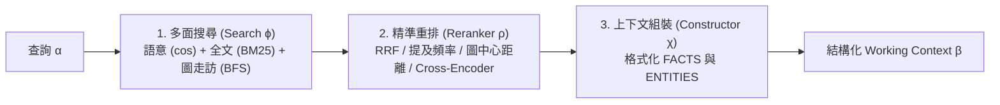

# 多面性圖譜記憶檢索（Multi-Faceted Graph Retrieval）

## 概念定義
多面性圖譜記憶檢索（Multi-Faceted Graph Retrieval）指結合語意相似性、全文關鍵詞比對與圖拓撲走訪的三階段檢索管線，將使用者查詢 $\alpha$ 轉化為兼具精確事實、時間有效區間與高階實體摘要的結構化上下文 $\beta$：
$$f(\alpha) = \chi(\rho(\phi(\alpha))) = \beta$$
(來源: ZEP.pdf, Section 3/Page 4)。

---

## 三階段檢索運作流程

### 1. 第一階段：多面搜尋（Search, $\phi$）
搜尋函數 $\phi : \mathcal{S} \to \mathcal{E}_s^n \times \mathcal{N}_s^n \times \mathcal{N}_c^n$ 同時產生語意邊、實體節點與社群節點三種圖物件之候選清單 (來源: ZEP.pdf, Section 3/Page 4)：
- **$\phi_{\text{cos}}$（餘弦語意搜尋）**：基於 Dense Embedding 捕捉語意相近性 (來源: ZEP.pdf, Section 3.1/Page 4-5)。
- **$\phi_{\text{bm25}}$（Okapi BM25 全文搜尋）**：透過 Neo4j 整合之 Apache Lucene 引擎比對文字字面重疊度 (來源: ZEP.pdf, Section 3.1/Page 4-5)。
- **$\phi_{\text{bfs}}$（圖廣度優先走訪）**：以近期對話情節（Episodes）為種子節點，在圖譜中進行 $n$-hop 拓撲擴展，直接檢索在對話上下文鄰近連通的實體與關係 (來源: ZEP.pdf, Section 3.1/Page 4-5)。

### 2. 第二階段：精準重排（Reranker, $\rho$）
為了在高召回率候選集上最大化推論精準度，Zep 提供多種重排策略 (來源: ZEP.pdf, Section 3.2/Page 5)：
- **排序融合演算法**：支援 Reciprocal Rank Fusion（RRF）與 Maximal Marginal Relevance（MMR）(來源: ZEP.pdf, Section 3.2/Page 5)。
- **情節提及頻率重排（Episode-Mentions Reranker）**：統計實體或事實於對話歷史中被提及的頻率，優先呈現使用者反覆討論的核心重點 (來源: ZEP.pdf, Section 3.2/Page 5)。
- **圖拓撲距離重排（Node Distance Reranker）**：計算候選節點與指定中心質心（Centroid Node）的圖幾何距離，鎖定局部知識領域 (來源: ZEP.pdf, Section 3.2/Page 5)。
- **Cross-Encoder 深度重排**：利用 LLM 交叉注意力模型為節點與邊計算精確相關度分數（計算成本最高但最精確）(來源: ZEP.pdf, Section 3.2/Page 5)。

### 3. 第三階段：上下文組裝（Constructor, $\chi$）
將精選出的候選物件格式化為結構化 XML 注入 Agent 的 Prompt 中 (來源: ZEP.pdf, Section 3/Page 4)：
- 邊事實：輸出文字陳述與有效時間區間 `(Date range: t_valid - t_invalid)` (來源: ZEP.pdf, Section 3/Page 4)。
- 實體節點：輸出實體名稱與精煉摘要 (來源: ZEP.pdf, Section 3/Page 4)。
- 社群節點：輸出社群高階主題摘要 (來源: ZEP.pdf, Section 3/Page 4)。

---

## 跨架構檢索機制對照

| 檢索維度 | Mem0 / Mem0^g | A-Mem | Zep (Graphiti) |
| :--- | :--- | :--- | :--- |
| **檢索搜尋範式** | 雙路：實體中心子圖 + 三元組密集向量匹配 (來源: Mem0.pdf, Section 2.2/Page 6) | 向量相似度比對 + 虛擬盒子（Virtual Boxes）連帶存取 (來源: A-Mem.pdf, Section 3.4/Page 5) | 三路搜尋合流：餘弦語意 + BM25 全文 + 近期情節種子之圖 BFS (來源: ZEP.pdf, Section 3.1/Page 4-5) |
| **重排機制** | 基於三元組語意分數門檻過濾 (來源: Mem0.pdf, Section 2.2/Page 6) | 依餘弦相似度選取 Top-$k$ (來源: A-Mem.pdf, Section 3.4/Page 5) | 支援 RRF、MMR、對話提及頻率、圖拓撲距離與 Cross-Encoder (來源: ZEP.pdf, Section 3.2/Page 5) |
| **注入上下文格式** | 自然語言事實字串 (來源: Mem0.pdf, Appendix A/Page 19) | 筆記屬性（內容、關鍵詞、標籤、上下文）(來源: A-Mem.pdf, Appendix B.4/Page 21) | 結構化 XML 標籤（`<FACTS>` 帶日期區間與 `<ENTITIES>` 帶摘要）(來源: ZEP.pdf, Section 3/Page 4) |

---

## 相關引用與頁面
- 出處論文：[[zep]]
- 圖譜架構：[[hierarchical_memory_subgraphs]]
- 時間模型：[[temporal_knowledge_graphs]]
- 成本延遲對比：[[memory_latency_cost_tradeoffs]]
- 跨架構綜合對照：[[architecture_comparison]]
