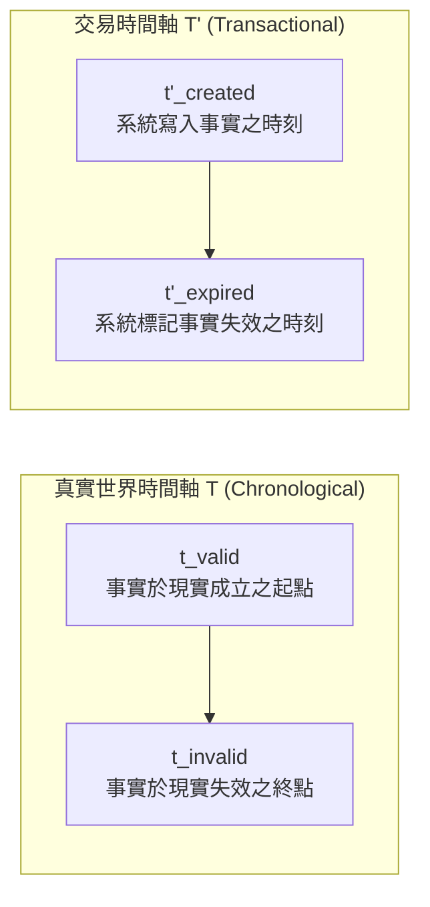

# 時間感知知識圖譜與雙時間軸模型（Temporal Knowledge Graphs & Bi-Temporal Modeling）

## 概念定義
時間感知知識圖譜（Temporal Knowledge Graphs）指將時間維度深度整合至實體與事實關係拓撲中的動態圖結構；其核心特徵在於維護「真實世界時間（Chronological Timeline, $T$）」與「資料庫交易時間（Transactional Timeline, $T'$）」之**雙時間軸模型（Bi-Temporal Model）**，使知識庫在吸收演進資訊時既能記錄現實狀態演變，亦能審計資料庫寫入歷程 (來源: ZEP.pdf, Section 2/Page 2, Section 2.1/Page 2)。

---

## 雙時間軸模型之四時間戳記結構
在 Zep 的 Graphiti 引擎中，圖譜的每條事實邊（Edge）皆儲存四個時間戳記 (來源: ZEP.pdf, Section 2.2.3/Page 3)：

1. **真實世界時間軸（$T$）**：
   - $t_{\text{valid}}$：事實關係在現實世界中開始成立的日期時間 (來源: ZEP.pdf, Section 2.2.3/Page 3)。
   - $t_{\text{invalid}}$：事實關係在現實世界中終止或被推翻的日期時間 (來源: ZEP.pdf, Section 2.2.3/Page 3)。
   - **相對時間解析**：透過對話發送時之基準時間戳記 $t_{\text{ref}}$，LLM 能夠精確將「兩週前」、「去年夏天」等相對時間詞換算為標準 ISO 8601 格式（`YYYY-MM-DDTHH:MM:SSZ`）並寫入邊屬性中 (來源: ZEP.pdf, Section 2.1/Page 2, Section 6.1.5/Page 10)。
2. **交易時間軸（$T'$）**：
   - $t'_{\text{created}}$：該筆事實紀錄正式寫入圖資料庫的系統時間 (來源: ZEP.pdf, Section 2.2.3/Page 3)。
   - $t'_{\text{expired}}$：該筆事實紀錄在資料庫層次被宣告過期/被取代的系統時間 (來源: ZEP.pdf, Section 2.2.3/Page 3)。

---

## 邊失效機制（Edge Invalidation）
當新對話引入與既有記憶相左之新事實時，傳統圖譜面臨物理覆寫導致歷史丟失的兩難。Zep 採用「邊失效」策略維護一致性 (來源: ZEP.pdf, Section 2.2.3/Page 3)：
- **語意衝突偵測**：LLM 比對新邊與既有語意相關邊，判定是否存在時序重疊的矛盾（例如先說「我住在西雅圖」，後說「我搬到舊金山了」）(來源: ZEP.pdf, Section 2.2.3/Page 3)。
- **時間戳記轉移**：依循交易時間軸 $T'$「新資訊優先」原則，系統將受影響舊邊的 $t_{\text{invalid}}$ 設為新邊的 $t_{\text{valid}}$，標記舊關係於特定時間點終止，而非自圖譜中物理刪除 (來源: ZEP.pdf, Section 2.2.3/Page 3)。
- **歷史軌跡保留**：此非損（Non-lossy）特性使 Agent 在面對「使用者去年住哪裡」與「使用者目前住哪裡」時，皆能透過檢索不同時間切片取得精確答案，在 LongMemEval 時序推理題型取得 38.4%~48.2% 的大幅準確率躍升 (來源: ZEP.pdf, Section 2.2.3/Page 3, Table 3/Page 7)。

---

## 與 Mem0^g 時序失效之對照
- **Mem0^g 機制**：將過期關係狀態標註為無效（Mark as Invalid），保留建立時間戳記以輔助 Temporal 任務 (來源: Mem0.pdf, Section 2.2/Page 6)。
- **Zep (Graphiti) 機制**：形式化定義雙時間軸（$T$ 與 $T'$）與四重時間戳記，將相對時間語法解析為區間 $[t_{\text{valid}}, t_{\text{invalid}}]$，在時間區間的數學描述與審計層面上更為嚴格 (來源: ZEP.pdf, Section 2.1/Page 2, Section 2.2.3/Page 3)。

---

## 相關引用與頁面
- 出處論文：[[zep]]
- 圖譜子圖架構：[[hierarchical_memory_subgraphs]]
- 檢索機制：[[multi_faceted_graph_retrieval]]
- 圖譜表徵比較：[[graph_memory_representations]]
- 綜合對比：[[architecture_comparison]]
