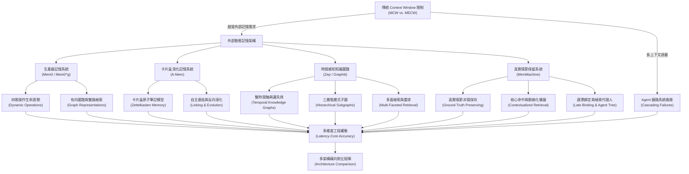

# LLM Memory Management 知識庫

歡迎查閱 LLM Memory Management 知識庫。本知識庫專門服務資工系與 AI 領域研究生，系統性梳理大語言模型記憶管理的核心挑戰、生命週期（Extraction, Consolidation, Retrieval）、架構演進與系統工程 Trade-offs。

---

## 推薦閱讀路徑

1. **第一步：理解純上下文窗口的物理與行為極限**
   - 閱讀 [[context_is_what_you_need]] 掌握模型宣稱窗口（MCW）與實際有效窗口（MECW）之巨大差距 (來源: Context_Is_What_You_Need.pdf, Abstract/Page 1)。
   - 研讀核心概念 [[mecw_vs_mcw]] 與 [[in_context_degradation]]，了解任務複雜度對注意力退化的非線性影響 (來源: Context_Is_What_You_Need.pdf, Section 1/Page 2, Section 3.1.2/Page 5-6)。
   - 查閱 [[cascading_failures]]，掌握多 Agent 鏈路在長上下文輸入下的級聯崩潰數學機制 (來源: Context_Is_What_You_Need.pdf, Appendix A2.2/Page 14, Section 7.3/Page 10)。
2. **第二步：研讀生產級密集與圖譜記憶（Mem0 / Mem0^g）**
   - 閱讀 [[mem0]] 掌握生產級記憶架構如何透過萃取與更新兩階段管線實現跨 Session 長期記憶 (來源: Mem0.pdf, Section 2/Page 3-5)。
   - 深入概念條目 [[dynamic_memory_operations]]，學習 ADD / UPDATE / DELETE / NOOP 四態生命週期操作與語意衝突裁決 (來源: Mem0.pdf, Section 2.1/Page 4, Appendix B/Page 21)。
   - 深入概念條目 [[graph_memory_representations]]，學習有向標記圖建模、實體子圖與三元組雙路檢索，以及時序失效標記（Temporal Invalidation）(來源: Mem0.pdf, Section 2.2/Page 5-6)。
3. **第三步：研讀免綱要之自主演化記憶架構（A-Mem）**
   - 閱讀 [[a_mem]] 掌握如何借鑒卡片盒筆記法（Zettelkasten）打破圖資料庫預定義 Schema 的僵化限制 (來源: A-Mem.pdf, Section 1/Page 1-2, Section 3/Page 3-5)。
   - 深入概念條目 [[zettelkasten_agentic_memory]]，理解原子筆記之七元組結構與多重虛擬盒子（Virtual Boxes）機制 (來源: A-Mem.pdf, Section 3.1/Page 4, Figure 2/Page 3)。
   - 深入概念條目 [[memory_evolution_and_linking]]，掌握新經驗寫入如何反向促使歷史鄰近筆記進行屬性重寫與動態網絡演化 (來源: A-Mem.pdf, Section 3.2-3.3/Page 4-5, Table 3/Page 7)。
4. **第四步：研讀時間感知階層式圖譜記憶（Zep / Graphiti）**
   - 閱讀 [[zep]] 掌握專門針對超長對話（115k tokens）與企業數據的時間感知知識圖譜架構 (來源: ZEP.pdf, Abstract/Page 1, Section 2/Page 2-4)。
   - 深入概念條目 [[temporal_knowledge_graphs]]，掌握真實世界時間 $T$ 與系統交易時間 $T'$ 雙時間軸及四重時間戳記與邊失效（Edge Invalidation）(來源: ZEP.pdf, Section 2.1/Page 2, Section 2.2.3/Page 3)。
   - 深入概念條目 [[hierarchical_memory_subgraphs]]，掌握情節子圖、語意實體子圖、社群子圖之階層劃分與動態標籤傳播（Dynamic Label Propagation）演算法 (來源: ZEP.pdf, Section 2/Page 2, Section 2.3/Page 4)。
   - 深入概念條目 [[multi_faceted_graph_retrieval]]，掌握複合搜尋（餘弦+BM25+圖BFS）、多策略重排與 XML 上下文組裝管線 (來源: ZEP.pdf, Section 3/Page 4-5)。
5. **第五步：研讀真實情節保留與檢索代理人架構（MemMachine）**
   - 閱讀 [[mem_machine]] 掌握「保留原始對話情節、免除常態性抽取、檢索端優化主導最終表現」的工程突破 (來源: MemMachine.pdf, Abstract/Page 1, Section 1.1/Page 2, Section 9.1/Page 13)。
   - 深入概念條目 [[ground_truth_preserving_architecture]]，理解壓縮 vs. 保留的根本設計張力、句子級切塊與消除抽取漂移 (來源: MemMachine.pdf, Section 2.2/Page 3, Section 4.4/Page 5, Section 9.1/Page 13)。
   - 深入概念條目 [[contextualized_retrieval]]，掌握對話嵌入不相似性困境、核心情節前後滑窗擴展（Cluster）與多查詢重排 (來源: MemMachine.pdf, Section 4.6/Page 6, Section 5.5/Page 7)。
   - 深入概念條目 [[late_binding_and_retrieval_agents]]，學習遲滯綁定難題與 Tool Tree 檢索代理人（ChainOfQuery、SplitQuery、直接檢索）與 APO 離線優化 (來源: MemMachine.pdf, Section 5/Page 6-8, Table 4/Page 8)。
6. **第六步：系統工程評估與多架構橫向綜合對比**
   - 研讀 [[memory_latency_cost_tradeoffs]]，分析 Full-Context、RAG、Mem0、A-Mem、Zep、MemMachine 在延遲、Token 消耗、準確率與 Pareto 最優解之全面權衡 (來源: Mem0.pdf, Table 2/Page 11; A-Mem.pdf, Table 4/Page 8; ZEP.pdf, Table 2/Page 7; MemMachine.pdf, Table 8/Page 10, Table 13/Page 13)。
   - 查閱 [[architecture_comparison]]，掌握各世代記憶管理機制之存儲載體、生命週期操作，以及跨團隊評測指標分歧之完整並陳對照。

---

## 知識庫全頁面清單

### 單篇文獻筆記（Papers）
- [[context_is_what_you_need]] — *Context Is What You Need: The Maximum Effective Context Window for Real World Limits of LLMs* (Norman Paulsen, 2025) (來源: Context_Is_What_You_Need.pdf, Page 1)
- [[mem0]] — *Mem0: Building Production-Ready AI Agents with Scalable Long-Term Memory* (Prateek Chhikara et al., 2025) (來源: Mem0.pdf, Page 1)
- [[a_mem]] — *A-Mem: Agentic Memory for LLM Agents* (Wujiang Xu et al., 2025) (來源: A-Mem.pdf, Page 1)
- [[zep]] — *ZEP: A Temporal Knowledge Graph Architecture for Agent Memory* (Preston Rasmussen et al., 2025) (來源: ZEP.pdf, Page 1)
- [[mem_machine]] — *MemMachine: A Ground-Truth-Preserving Memory System for Personalized AI Agents* (Shu Wang et al., 2026) (來源: MemMachine.pdf, Page 1)

### 核心概念條目（Concepts）
- [[mecw_vs_mcw]] — 最大有效上下文窗口（MECW）與最大架構窗口（MCW）定義、光譜特性與實證落差 (來源: Context_Is_What_You_Need.pdf, Section 1/Page 1-2, Appendix A2.1/Page 14)
- [[cascading_failures]] — 多 Agent 鏈路中的級聯失敗效應與上下文過載分析 (來源: Context_Is_What_You_Need.pdf, Section 7.3/Page 10, Appendix A2.2/Page 14)
- [[in_context_degradation]] — 隨任務複雜度與 token 數量攀升的記憶崩塌模式 (來源: Context_Is_What_You_Need.pdf, Section 3.1.2/Page 5-6, Figure 5/Page 8)
- [[dynamic_memory_operations]] — ADD / UPDATE / DELETE / NOOP 四態記憶生命週期操作與衝突解決 (來源: Mem0.pdf, Section 2.1/Page 4, Appendix B/Page 21)
- [[graph_memory_representations]] — 有向標記圖表徵、雙路檢索與時序失效機制 (來源: Mem0.pdf, Section 2.2/Page 5-6)
- [[zettelkasten_agentic_memory]] — 卡片盒式原子筆記模型、七元組屬性與多重虛擬盒子 (來源: A-Mem.pdf, Section 3.1/Page 4, Figure 2/Page 3)
- [[memory_evolution_and_linking]] — 自主連結生成（LG）與反向歷史記憶演化（ME）機制 (來源: A-Mem.pdf, Section 3.2-3.3/Page 4-5, Table 3/Page 7)
- [[temporal_knowledge_graphs]] — 雙時間軸模型（$T$ 與 $T'$）與邊失效機制 (來源: ZEP.pdf, Section 2.1/Page 2, Section 2.2.3/Page 3)
- [[hierarchical_memory_subgraphs]] — 情節、語意實體與社群三層子圖及動態標籤傳播 (來源: ZEP.pdf, Section 2/Page 2, Section 2.3/Page 4)
- [[multi_faceted_graph_retrieval]] — 多路搜尋（語意+BM25+圖BFS）、重排與 XML 上下文組裝 (來源: ZEP.pdf, Section 3/Page 4-5)
- [[ground_truth_preserving_architecture]] — 真實情節非損保存、免常態抽取與檢索端主導規律 (來源: MemMachine.pdf, Section 1.1/Page 2, Section 4.4/Page 5, Section 9.1/Page 13)
- [[contextualized_retrieval]] — 對話嵌入不相似性困境、核心情節脈絡擴展與多查詢重排 (來源: MemMachine.pdf, Section 4.6/Page 6, Section 5.5/Page 7)
- [[late_binding_and_retrieval_agents]] — 多跳遲滯綁定難題與 Tool Tree 檢索代理人架構 (來源: MemMachine.pdf, Section 5/Page 6-8, Table 4/Page 8)
- [[memory_latency_cost_tradeoffs]] — 記憶系統在品質、搜尋延遲、總延遲與 Token 儲存體積之權衡矩陣 (來源: Mem0.pdf, Table 2/Page 11; A-Mem.pdf, Table 4/Page 8; ZEP.pdf, Table 2/Page 7; MemMachine.pdf, Table 8/Page 10, Table 13/Page 13)

### 跨架構綜合分析（Syntheses）
- [[architecture_comparison]] — 傳統 Context Window、Mem0/Mem0^g、A-Mem、ZEP 與 MemMachine 多維度並陳對比表

### 運作日誌（Log）
- [[log]] — 知識庫 Ingest 歷程與 Lint 檢查紀錄

---

## 原始文獻庫（Raw Sources）
- `raw/Context_Is_What_You_Need.pdf` — *Context Is What You Need: The Maximum Effective Context Window for Real World Limits of LLMs* (Norman Paulsen, 2025)
- `raw/Mem0.pdf` — *Mem0: Building Production-Ready AI Agents with Scalable Long-Term Memory* (Prateek Chhikara et al., 2025)
- `raw/A-Mem.pdf` — *A-Mem: Agentic Memory for LLM Agents* (Wujiang Xu et al., 2025)
- `raw/ZEP.pdf` — *ZEP: A Temporal Knowledge Graph Architecture for Agent Memory* (Preston Rasmussen et al., 2025)
- `raw/MemMachine.pdf` — *MemMachine: A Ground-Truth-Preserving Memory System for Personalized AI Agents* (Shu Wang et al., 2026)
