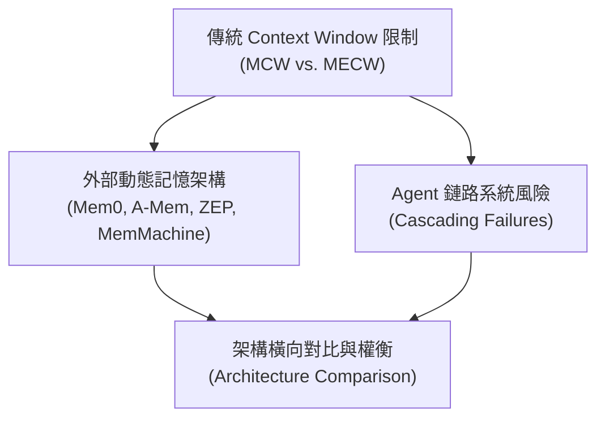

# LLM Memory Management 知識庫

歡迎查閱 LLM Memory Management 知識庫。本知識庫專門服務資工系與 AI 領域研究生，系統性梳理大語言模型記憶管理的核心挑戰、生命週期（Extraction, Consolidation, Retrieval）、架構演進與系統工程 Trade-offs。

---

## 推薦閱讀路徑

1. **第一步：理解純上下文窗口的物理與行為極限**
   - 閱讀 [[context_is_what_you_need]] 掌握模型宣稱窗口（MCW）與實際有效窗口（MECW）之巨大差距 (來源: Context_Is_What_You_Need.pdf, Abstract/Page 1)。
   - 研讀核心概念 [[mecw_vs_mcw]] 與 [[in_context_degradation]]，了解任務複雜度對注意力退化的非線性影響 (來源: Context_Is_What_You_Need.pdf, Section 1/Page 2, Section 3.1.2/Page 5-6)。
2. **第二步：評估 Agent 系統與長上下文的互動風險**
   - 查閱 [[cascading_failures]]，掌握多 Agent 鏈路在長上下文輸入下的級聯崩潰數學機制 (來源: Context_Is_What_You_Need.pdf, Appendix A2.2/Page 14, Section 7.3/Page 10)。
3. **第三步：跨架構橫向綜合對比**
   - 查閱 [[architecture_comparison]]，掌握各世代記憶管理機制之存儲載體、提取/更新/檢索機制與工程權衡。

---

## 知識庫全頁面清單

### 單篇文獻筆記（Papers）
- [[context_is_what_you_need]] — *Context Is What You Need: The Maximum Effective Context Window for Real World Limits of LLMs* (Norman Paulsen, 2025) (來源: Context_Is_What_You_Need.pdf, Page 1)

### 核心概念條目（Concepts）
- [[mecw_vs_mcw]] — 最大有效上下文窗口（MECW）與最大架構窗口（MCW）定義、光譜特性與實證落差 (來源: Context_Is_What_You_Need.pdf, Section 1/Page 1-2, Appendix A2.1/Page 14)
- [[cascading_failures]] — 多 Agent 鏈路中的級聯失敗效應與上下文過載分析 (來源: Context_Is_What_You_Need.pdf, Section 7.3/Page 10, Appendix A2.2/Page 14)
- [[in_context_degradation]] — 隨任務複雜度與 token 數量攀升的記憶崩塌模式 (來源: Context_Is_What_You_Need.pdf, Section 3.1.2/Page 5-6, Figure 5/Page 8)

### 跨架構綜合分析（Syntheses）
- [[architecture_comparison]] — 傳統 Context Window 與新世代記憶系統（Mem0、A-Mem、ZEP、MemMachine）多維度並陳對比表

### 運作日誌（Log）
- [[log]] — 知識庫 Ingest 歷程與 Lint 檢查紀錄

---

## 原始文獻庫（Raw Sources）
- `raw/Context_Is_What_You_Need.pdf` — *Context Is What You Need: The Maximum Effective Context Window for Real World Limits of LLMs* (Norman Paulsen, 2025)
