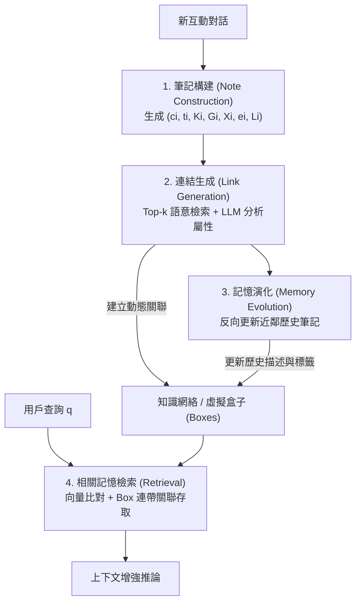

# A-Mem: Agentic Memory for LLM Agents

## 白話一句話定義
A-Mem 是一套借鑒卡片盒筆記法（Zettelkasten）的自主代理人記憶架構，將對話封裝為具備上下文描述、關鍵詞、標籤與向量的「原子筆記」，並透過新記憶自動觸發「動態連結生成」與「歷史記憶反向演化（Memory Evolution）」，打破了傳統圖譜記憶對預定義綱要（Predefined Schema）的依賴，實現自組織且持續深化的知識網路 (來源: A-Mem.pdf, Abstract/Page 1, Section 1/Page 1-2, Section 3/Page 3-5)。

---

## 核心痛點
1. **預定義綱要與固定工作流的僵化束縛**：
   - 現有記憶系統（如早期記憶庫或 Mem0 等圖譜記憶）高度依賴預先設定的 Schema、儲存結構與檢索時機 (來源: A-Mem.pdf, Section 1/Page 1, Section 2.1/Page 2)。當 Agent 在未知環境中學習到全新領域知識（例如新型數學解法）時，預設框架無法自行湧現新的關聯模式或拓展組織架構 (來源: A-Mem.pdf, Section 1/Page 1-2)。
2. **缺乏記憶自導演化能力（Lack of Memory Evolution）**：
   - 儘管 Agentic RAG 在檢索階段能動態決定「何時檢索」，但底層知識庫本質上仍是靜態的（Static Knowledge Base），無法隨新經驗輸入自動更新、反思與重塑既有歷史記憶 (來源: A-Mem.pdf, Section 1/Page 1, Section 2.2/Page 3)。
3. **長程對話中的多跳推理斷裂**：
   - 在多 Session 跨度的複雜任務中，簡單的事實檢索無法拼湊出長鏈條的因果與上下文聯繫，導致多跳（Multi-Hop）推理表現低下 (來源: A-Mem.pdf, Section 1/Page 2, Section 4.3/Page 6-7)。

---

## 系統架構與運作流程

A-Mem 借鑒卡片盒筆記法，將記憶組織為兼具結構化屬性與靈活連結的網狀系統，包含四大階段 (來源: A-Mem.pdf, Section 3/Page 3-5, Figure 2/Page 3)：

### 1. 筆記構建（Note Construction）
遵循卡片盒原子性原則（Atomicity），每次互動被轉化為獨立自包含的筆記 $m_i \in \mathcal{M}$ (來源: A-Mem.pdf, Section 3.1/Page 4)：
$$m_i = \{c_i, t_i, K_i, G_i, X_i, e_i, L_i\}$$
- $c_i$：原始互動文字內容 (來源: A-Mem.pdf, Section 3.1/Page 4)。
- $t_i$：互動發生的時間戳記 (來源: A-Mem.pdf, Section 3.1/Page 4)。
- $K_i$：LLM 生成之核心關鍵詞清單（名詞、動詞、核心概念）(來源: A-Mem.pdf, Section 3.1/Page 4, Appendix B.1/Page 19)。
- $G_i$：LLM 生成之範疇標籤（領域、格式、型態）(來源: A-Mem.pdf, Section 3.1/Page 4, Appendix B.1/Page 19)。
- $X_i$：LLM 生成之一兩句上下文摘要描述（說明主要主題、論點與目的）(來源: A-Mem.pdf, Section 3.1/Page 4, Appendix B.1/Page 19)。
- $e_i$：稠密向量表徵，透過文字編碼器（如 `all-minilm-l6-v2`）對上述所有文本串接進行編碼：
  $$e_i = f_{\text{enc}}[\text{concat}(c_i, K_i, G_i, X_i)]$$
  (來源: A-Mem.pdf, Section 3.1/Page 4, Section 4.2/Page 6)。
- $L_i$：語意關聯之連結記憶清單 (來源: A-Mem.pdf, Section 3.1/Page 4)。

### 2. 連結生成（Link Generation）
新筆記 $m_n$ 寫入時，系統自主建立關聯而不依賴預設規則 (來源: A-Mem.pdf, Section 3.2/Page 4)：
1. 以餘弦相似度 $s_{n,j} = \frac{e_n \cdot e_j}{|e_n||e_j|}$ 篩選出 Top-$k$ 個最相關的歷史近鄰記憶集合 $M_{\text{near}}^n$ (來源: A-Mem.pdf, Section 3.2/Page 4)。
2. 將候選近鄰與新筆記傳入 LLM（Prompt $P_{s2}$），由 LLM 判斷深層潛在關聯（因果關係、概念延伸等），生成動態連結集 $L_i \leftarrow \text{LLM}(m_n \parallel M_{\text{near}}^n \parallel P_{s2})$ (來源: A-Mem.pdf, Section 3.2/Page 4, Appendix B.2/Page 19)。
3. **多重盒子機制（Multiple Boxes）**：與實體卡片盒不同，A-Mem 允許同一則記憶同時存在於多個主題不同的虛擬「Box」中 (來源: A-Mem.pdf, Figure 2/Page 3)。

### 3. 記憶演化（Memory Evolution）
新記憶的加入不僅建立連結，還會**反向刺激歷史記憶更新** (來源: A-Mem.pdf, Section 3.3/Page 4-5)：
- 對於近鄰集合中的每一則歷史記憶 $m_j \in M_{\text{near}}^n$，系統由 LLM（Prompt $P_{s3}$）評估是否需要動態重構其上下文描述、關鍵詞與標籤：
  $$m_j^* \leftarrow \text{LLM}(m_n \parallel M_{\text{near}}^n \setminus \{m_j\} \parallel m_j \parallel P_{s3})$$
  (來源: A-Mem.pdf, Section 3.3/Page 5, Appendix B.3/Page 20)。
- 演化後的筆記 $m_j^*$ 直接在記憶庫中替換舊筆記 $m_j$，支援強化連結（strengthen）、合併（merge）或修剪（prune）操作，促使記憶網絡隨經驗累積自主提煉出高階認知模式 (來源: A-Mem.pdf, Section 3.3/Page 5, Appendix B.3/Page 20)。

### 4. 相關記憶檢索（Memory Retrieval）
- 給定當前輸入查詢 $q$，計算其稠密向量 $e_q = f_{\text{enc}}(q)$，與記憶庫各筆記計算餘弦相似度 $s_{q,i} = \frac{e_q \cdot e_i}{|e_q||e_i|}$ (來源: A-Mem.pdf, Section 3.4/Page 5)。
- 檢索 Top-$k$ 個相關記憶組合為 Context，且當某則記憶被檢索出時，同一個「Box」內透過動態連結關聯的記憶亦會連帶提供給 Agent，大幅拓展多跳線索涵蓋率 (來源: A-Mem.pdf, Section 3.4/Page 5, Figure 2/Page 3)。

---

## 寫入 / 更新機制
- **寫入機制（Extraction & Ingestion）**：
  - 非單純儲存對話原始字串，而是經由 LLM 提煉出三重視角屬性（Context, Keywords, Tags），並計算複合語意嵌入向量 (來源: A-Mem.pdf, Section 3.1/Page 4)。
- **更新與演化機制（Consolidation & Evolution）**：
  - **雙向動態更新**：有別於傳統「只更新當前項目」或「單向覆寫」，A-Mem 的寫入會引發近鄰歷史筆記的重寫（Rewrite / Refine），動態調整舊筆記的語意邊界與標籤 (來源: A-Mem.pdf, Section 3.3/Page 4-5)。
  - **自組織聚類**：t-SNE 視覺化實證，經由記憶演化與連結機制後，記憶嵌入在空間中呈現高度收斂且清晰的語意群集（Coherent Clusters），而非演化前的發散分佈 (來源: A-Mem.pdf, Section 4.7/Page 9, Figure 4/Page 9)。

---

## 評測實驗與實證數據

### 1. 實驗設置與多模型評測
- **評測基準**：
  - **LoCoMo 資料集**：7,512 問答對，平均 9k tokens，橫跨 35 個 Sessions，涵蓋 Multi-Hop, Temporal, Open Domain, Single Hop, Adversarial 5 類 (來源: A-Mem.pdf, Section 4.1/Page 5)。
  - **DialSim 資料集**：影集長程多方對話（六人行、生活大爆炸等），1,300 Sessions、350,000 tokens (來源: A-Mem.pdf, Section 4.1/Page 5)。
- **基礎模型**：GPT-4o-mini, GPT-4o, Qwen2.5 (1.5B, 3B), Llama 3.2 (1B, 3B)；附錄涵蓋 DeepSeek-R1-32B, Claude 3.0/3.5 Haiku (來源: A-Mem.pdf, Section 4.1/Page 6, Table 7/Page 17)。

### 2. 關鍵表現數據（LoCoMo 基準）
依據 Table 1 數據 (來源: A-Mem.pdf, Table 1/Page 6)：
- **在開源模型（Qwen, Llama）上取得全面第一**：
  - Qwen2.5-1.5B：Multi-Hop F1 為 **18.23**（LoCoMo 僅 9.05，MemGPT 僅 10.44）；Temporal F1 為 **24.32**（LoCoMo 4.25，MemGPT 4.21）(來源: A-Mem.pdf, Table 1/Page 6)。
  - Llama 3.2-1B：Multi-Hop F1 為 **19.06**（LoCoMo 11.25，MemGPT 9.19）；Temporal F1 為 **17.80**（LoCoMo 7.38，MemGPT 4.02）(來源: A-Mem.pdf, Table 1/Page 6)。
  - 在所有小參數開源模型上，A-Mem 的綜合排名皆為全場最佳的 **1.0** (來源: A-Mem.pdf, Table 1/Page 6)。
- **在 GPT-4o-mini 上之表現**：
  - Multi-Hop：F1 為 **27.02**（超越 MemGPT 的 26.65 與 LoCoMo 的 25.02）；ROUGE-L 達 **44.27**（為 LoCoMo 18.09 的兩倍以上）(來源: A-Mem.pdf, Table 1/Page 6, Section 4.3/Page 7, Table 5/Page 16)。
  - Temporal：F1 為 **45.85**（大幅領先 LoCoMo 的 18.41 與 MemGPT 的 25.52）(來源: A-Mem.pdf, Table 1/Page 6)。
  - Single-Hop：F1 為 **44.65** (來源: A-Mem.pdf, Table 1/Page 6)。
- **Token 消耗顯著縮減**：
  - A-Mem 在 GPT-4o-mini 下平均每題僅消耗 **2,520 tokens**（GPT-4o 下僅 **1,216 tokens**），相較 LoCoMo（16,910 tokens）與 MemGPT（16,977 tokens）縮減達 **85%~93%** (來源: A-Mem.pdf, Table 1/Page 6, Section 4.3/Page 7)。

### 3. 消融實驗（Ablation Study, Table 3）
驗證「連結生成（LG）」與「記憶演化（ME）」之獨立貢獻 (來源: A-Mem.pdf, Section 4.4/Page 7, Table 3/Page 7)：
- 移除兩者（w/o LG & ME）：Multi-Hop F1 由 27.02 驟降至 **9.65**；Temporal F1 由 45.85 暴跌至 **24.55** (來源: A-Mem.pdf, Table 3/Page 7)。
- 僅保留連結生成（w/o ME）：Multi-Hop F1 為 **21.35**，Temporal F1 為 **31.24** (來源: A-Mem.pdf, Table 3/Page 7)。
- 結論：連結生成構築了知識網路之骨幹，而記憶演化則透過動態修飾屬性完成精細化，兩者互補不可或缺 (來源: A-Mem.pdf, Section 4.4/Page 7)。

### 4. 百萬級規模擴展性（Scaling Analysis, Table 4）
當記憶庫筆記由 1,000 條擴增至 1,000,000 條時 (來源: A-Mem.pdf, Section 4.6/Page 8, Table 4/Page 8)：
- **空間複雜度**：嚴格維持 $\mathcal{O}(N)$ 線性增長（1,000 筆為 1.46 MB；100 萬筆為 1464.84 MB），未引入多餘空間負擔 (來源: A-Mem.pdf, Table 4/Page 8)。
- **檢索時間**：由 $0.31 \mu\text{s}$ 僅微幅升至 **$3.70 \mu\text{s}$**（微秒級），遠優於 ReadAgent 的 $120,069.68 \mu\text{s}$ (來源: A-Mem.pdf, Table 4/Page 8)。
- **單次運作成本**：每筆操作約 1,200 tokens，單次成本低於 \$0.0003；在本地單張 GPU 執行 Llama 3.2 1B 耗時僅 1.1 秒 (來源: A-Mem.pdf, Section 4.3/Page 7)。

---

## 優缺點與 Trade-offs

### 優點
1. **擺脫預設綱要的自主結構化（Schema-Free）**：
   - 透過 Zettelkasten 卡片盒筆記模型，能自主生成標籤、關鍵詞與上下文描述，在面對未知開放領域知識時具備極高彈性 (來源: A-Mem.pdf, Section 1/Page 1-2, Section 3.1/Page 4)。
2. **記憶具備生命力（動態反向演化）**：
   - 新記憶會反向修正歷史筆記的標籤與描述，使整體知識網絡隨互動持續演化與提煉 (來源: A-Mem.pdf, Section 3.3/Page 4-5)。
3. **在小參數開源模型與多跳推理上優勢顯著**：
   - 在 Qwen 與 Llama 1B~3B 上展現極強適應力，綜合排名達全場最優的 1.0 (來源: A-Mem.pdf, Table 1/Page 6)。

### 缺點與跨文獻 Trade-offs / 觀點衝突
1. **寫入期依賴多次 LLM 調用**：
   - 每次寫入新記憶皆需調用 LLM 進行筆記構建、Top-$k$ 近鄰連結分析與近鄰記憶演化重寫，推論呼叫次數較多（GPT-4o-mini 處理耗時約 5.4 秒）(來源: A-Mem.pdf, Section 4.3/Page 7)。
2. **跨文獻評測觀點衝突（A-Mem vs. Mem0）**：
   - **A-Mem 作者觀點**：在 LoCoMo 的 F1/BLEU/ROUGE 指標上，A-Mem 的 Multi-Hop 得分大幅超越 LoCoMo 與 MemGPT（F1=27.02，ROUGE-L 達 44.27 提升一倍以上），且檢索開銷極小 (來源: A-Mem.pdf, Table 1/Page 6, Section 4.3/Page 7)。
   - **Mem0 論文反向實測觀點**：Mem0 團隊在 LOCOMO 基準上以 GPT-4o-mini 重測 A-Mem，測得 A-Mem 的 LLM-as-a-Judge ($J$) 得分僅為 **48.38%**（Mem0 為 66.88%），且其搜尋延遲（p50=0.668s）高於 Mem0（0.148s），指出 A-Mem 在更嚴格的事實語意裁判下存在多跳整合不足之缺陷 (來源: Mem0.pdf, Table 1-2/Page 9, 11, Section 4.4/Page 13)。
   - *（依據知識庫規範，上述衝突觀點已完整並陳，詳見 [[architecture_comparison]]）*。

---

## 相關核心條目
- [[zettelkasten_agentic_memory]]：卡片盒原子筆記結構、多重虛擬盒子與免綱要建模。
- [[memory_evolution_and_linking]]：自主連結生成（LG）與反向記憶演化（ME）機制。
- [[dynamic_memory_operations]]：Mem0 的四態操作與 A-Mem 筆記演化之對比。
- [[graph_memory_representations]]：Neo4j 實體關係圖譜 vs. 卡片盒網狀動態連結。
- [[memory_latency_cost_tradeoffs]]：全上下文、向量記憶、圖譜記憶與演化筆記之多維度權衡。
- [[architecture_comparison]]：跨文獻記憶架構總對比表。
