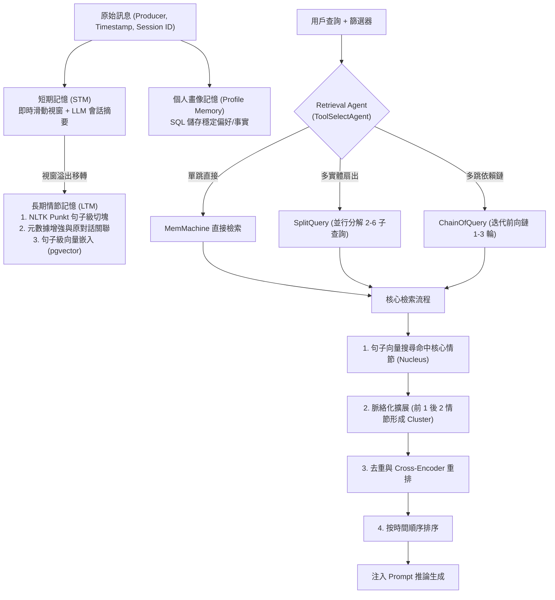

# MemMachine: A Ground-Truth-Preserving Memory System for Personalized AI Agents

## 白話一句話定義
MemMachine 是一套堅持「保留原始真實情節（Ground-Truth-Preserving）」的開源 AI 代理人記憶系統，捨棄昂貴且易失真的常態性逐則訊息 LLM 萃取，改以句子級切塊索引原始對話，透過「脈絡化擴展檢索（Contextualized Retrieval）」補齊對話前後文，並以「檢索代理人（Retrieval Agent）」解決多跳推理中的遲滯綁定問題，在 LoCoMo（0.9169）與 LongMemEval（93.0%）取得頂尖表現，同時較 Mem0 節省約 80% Token 輸入 (來源: MemMachine.pdf, Abstract/Page 1, Section 1.1/Page 2, Section 4/Page 4-6)。

---

## 核心痛點
1. **常態性 LLM 萃取的複合性誤差與高昂成本（Compounding Error & Cost）**：
   - 既有記憶系統（如 Mem0 與 Zep）高度仰賴 LLM 對每則對話進行實體關係或事實萃取、更新與刪除；這種機率性抽取不僅產生極高的 Token 呼叫成本，更會隨時間推移產生事實漂移（Factual Drift）與錯誤累積 (來源: MemMachine.pdf, Section 1/Page 2, Section 2.2/Page 2)。
2. **對話語句的嵌入不相似性困境（Embedding Dissimilarity Problem）**：
   - 傳統 RAG 處理獨立文件 Chunk，但真實對話輪次（Turns）高度互相依賴。例如使用者詢問「那家餐廳推薦」，關鍵條件與約束往往分佈在前幾輪（問了什麼、限制為何），單純依靠向量比對命中的核心句子往往缺乏上下文，導致 LLM 無法準確理解 (來源: MemMachine.pdf, Section 4.6/Page 6)。
3. **多跳推理中的遲滯綁定問題（Late Binding Problem）**：
   - 對於鏈狀依賴查詢（如「Acme 公司執行長配偶的現任雇主是誰？」），在第一步解析出執行長、第二步解析出配偶之前，根本無法預先以單一向量檢索命中第三步的雇主；單次向量搜尋無法跨越未知的依賴中介實體 (來源: MemMachine.pdf, Section 5/Page 6, Section 5.1/Page 6)。
4. **寫入端過度優化（Ingestion Over-engineering）**：
   - 大量系統投入重度工程於寫入期構建知識圖譜，但 MemMachine 實證發現，檢索階段的優化效益（檢索深度 +4.2%、格式排版 +2.0%、提示詞設計 +1.8%）遠大於寫入端句子切塊（+0.8%），顯示「資料如何被召回」遠比「資料如何被抽取」更具工程影響力 (來源: MemMachine.pdf, Abstract/Page 1, Section 9.1/Page 13)。

---

## 系統架構與運作流程

MemMachine 採客戶端-伺服器架構，提供 RESTful API (v2)、Python SDK 與 MCP（Model Context Protocol）伺服器介面，儲存層整合 PostgreSQL（pgvector 支援向量檢索）、SQLite 與 Neo4j (來源: MemMachine.pdf, Section 4.1/Page 4)。

### 1. 三層記憶體系劃分
借鑒認知科學 Tulving 與 Atkinson-Shiffrin 記憶模型 (來源: MemMachine.pdf, Section 2.4/Page 3, Section 3/Page 3-4)：
- **短期記憶（Short-Term Memory, STM）**：維護最近若干對話情節之工作區，當內容超出視窗時，透過 LLM 生成會話級壓縮摘要，隨後轉入長期記憶 (來源: MemMachine.pdf, Section 4.3/Page 5)。
- **長期情節記憶（Long-Term Episodic Memory, LTM）**：
  - 儲存「發生的具體事件真相」（Ground Truth）(來源: MemMachine.pdf, Section 3.1/Page 3-4)。
  - **句子級抽取管線**：使用 NLTK Punkt 分詞器將情節拆解為句子級細顆粒度，句子繼承母情節時間戳記與發話者元數據，計算句子嵌入向量，並在圖中保留與母情節之關聯 (來源: MemMachine.pdf, Section 4.4/Page 5)。
- **語意/個人畫像記憶（Profile Memory）**：
  - 儲存自經驗提煉的高階使用者屬性（人口統計資訊、明確偏好、行為模式、專業領域），存於關聯式 SQL 資料庫，支援衝突覆寫與知識更新 (來源: MemMachine.pdf, Section 3.2/Page 4, Section 4.7/Page 6)。
- **程序記憶（Procedural Memory）**：目前架構預留但不實作，未來可擴充支援工具調用模式與策略重用 (來源: MemMachine.pdf, Section 3.3/Page 4)。

---

## 寫入 / 更新機制
- **非損原始儲存與最小化 LLM 依賴**：
  - 寫入對話時**不進行常態性實體三元組或事實抽取**，原汁原味保存對話情節 (來源: MemMachine.pdf, Section 1.1/Page 2, Section 6.1/Page 9)。
  - LLM 僅在三種情境下被審慎調用：(1) STM 視窗溢出時的會話摘要、(2) 個人畫像屬性萃取、(3) Agent 模式下的多輪推理。常態儲存完全由規則與輕量分詞器驅動，從根本上杜絕事實漂移並縮減 80% Token 消耗 (來源: MemMachine.pdf, Section 6.1/Page 9, Section 6.3/Page 9-10)。
- **租戶與專案隔離**：支援 `org_id/project_id` 專案級命名空間隔離，以及 `user_id`, `agent_id`, `session_id` 實例級多租戶劃分 (來源: MemMachine.pdf, Section 4.8/Page 6)。

---

## 檢索機制：脈絡化擴展與檢索代理人

### 1. 脈絡化擴展檢索（Contextualized Retrieval）
解決對話語義碎片化問題 (來源: MemMachine.pdf, Section 4.6/Page 6)：
1. **核心情節定位（Nucleus Episode）**：透過句子級向量檢索定位最高相關句子及其母情節 (來源: MemMachine.pdf, Section 4.6/Page 6)。
2. **前後文滑窗擴展**：自動抓取核心情節**前 1 則、後 2 則**相鄰情節，拼裝為一個完整的「情節聚類（Episode Cluster）」(來源: MemMachine.pdf, Section 4.6/Page 6)。
3. **跨編碼器重排（Cross-Encoder Reranking）**：對情節聚類整體評分重排，並按時間序列排序後傳入 LLM (來源: MemMachine.pdf, Section 4.5/Page 5, Section 4.6/Page 6)。

### 2. 檢索代理人（Retrieval Agent）與遲滯綁定解法
為解決多跳推理中的 Late Binding 難題，MemMachine v0.3 引入可組合的 Tool Tree 檢索架構 (來源: MemMachine.pdf, Section 5/Page 6-7, Figure 3/Page 7)：
- **ToolSelectAgent（路由節點）**：以單次 LLM 呼叫分類問題結構：
  - **Multi-hop 依賴鏈** $\to$ 分發至 **ChainOfQuery**：執行最多 3 輪前向鏈迭代，每輪包含檢索、充分性判斷（信心度 $\ge 0.8$ 提前終止）與基於實體的事實改寫，將多跳橋接問題召回率提升至 95.31% (來源: MemMachine.pdf, Section 5.3-5.4/Page 7, Table 4/Page 8)。
  - **Single-hop 多實體扇出** $\to$ 分發至 **SplitQuery**：分解為 2~6 個獨立單事實子查詢，透過 `asyncio.gather()` 並行檢索並合併結果 (來源: MemMachine.pdf, Section 5.3-5.4/Page 7)。
  - **Single-hop 直接檢索** $\to$ 分發至 **MemMachine 葉節點**：直接執行聲明式向量檢索，無額外分解開銷 (來源: MemMachine.pdf, Section 5.3-5.4/Page 7)。
- **多查詢重排（Multi-Query Reranking）**：重排模型接收檢索過程中產生的所有衍生查詢（原始問題 + 改寫題 + 子查詢）之串接，確保多跳鏈條中不含原始關鍵詞的中介事實亦能獲得高權重 (來源: MemMachine.pdf, Section 5.5/Page 7)。

---

## 評測實驗與實證數據

### 1. LoCoMo 基準對比（Table 10 & 11）
- **GPT-4.1-mini 配置**：
  - MemMachine v0.2 在 Agent 模式下取得 **0.9169** 總分，在 Memory 模式下取得 **0.9123**，其中 Single-Hop 達 0.9512，Temporal 達 0.9159 (來源: MemMachine.pdf, Table 10/Page 12)。
- **GPT-4o-mini 公平對比基準（Table 11）**：
  - **MemMachine v0.2**: **0.8747**（Single-hop: 0.9465, Multi-hop: 0.8759, Temporal: 0.7352, Open-domain: 0.7083）。
  - **Memobase**: 0.7578。
  - **Zep**: 0.7514。
  - **Mem0**: 0.6688。
  - **LangMem**: 0.5810。
  - **OpenAI**: 0.5290。
  - *領先次優系統（Memobase）達 9.7 個百分點，全面領先 Zep 與 Mem0* (來源: MemMachine.pdf, Section 8.2/Page 11, Table 11/Page 12)。
- **Token 消耗對比（Table 8）**：
  - 在 LoCoMo 上，MemMachine Memory 模式僅消耗 4.20M 輸入 tokens，而 Mem0 消耗 19.21M tokens；**MemMachine 節省約 78%~80% 的輸入 Token** (來源: MemMachine.pdf, Section 6.3/Page 9-10, Table 8/Page 10)。

### 2. LongMemEvalS 企業長對話基準（115k tokens, ICLR 2025）
- **六大優化維度消融貢獻（Table 13）**：
  - 檢索深度優化（$k: 20 \to 30$）：**+4.2%** (來源: MemMachine.pdf, Table 13/Page 13)。
  - 模型選型（GPT-5 $\to$ GPT-5-mini）：**+2.6%** (來源: MemMachine.pdf, Table 13/Page 13)。
  - 上下文排版（JSON-str 斷行隔離）：**+2.0%** (來源: MemMachine.pdf, Table 13/Page 13)。
  - 搜尋 Prompt 設計（Edwin3）：**+1.8%** (來源: MemMachine.pdf, Table 13/Page 13)。
  - 簡化 Prompt（移除 CoT 直接指令）：**+1.6%** (來源: MemMachine.pdf, Table 13/Page 13)。
  - 使用者查詢偏差修正（前綴 `"user:"`）：**+1.4%** (來源: MemMachine.pdf, Table 13/Page 13)。
  - 寫入端句子切塊（Sentence Chunking）：僅 **+0.8%** (來源: MemMachine.pdf, Table 13/Page 13)。
- **最高分與 Pareto 最優組態**：
  - 最佳組態（C15, GPT-5-mini, $k=100$）：達到 **93.0%** 總體準確率 (來源: MemMachine.pdf, Table 1/Page 1, Table 12/Page 13)。
  - Pareto 最優組態（C12, GPT-5-mini, $k=20$）：以僅 2.58M 輸入 Token 達到 **92.2%** 準確率 (來源: MemMachine.pdf, Section 8.4.8/Page 12-13)。
- **GPT-5-mini 反超 GPT-5 發現**：搭配簡潔直接的 Edwin3 提示詞時，GPT-5-mini 準確率反超 GPT-5 達 2.6%（0.922 vs. 0.896），原因在於精簡 Prompt 契合小模型強悍的指令遵循能力，而大模型內建 CoT 反受多餘引導干擾 (來源: MemMachine.pdf, Section 8.4.6/Page 12)。

### 3. 多跳基準表現（HotpotQA & WikiMultiHop）
- **HotpotQA Hard 集**：Retrieval Agent 達到 **93.2%** 準確率（高於 Baseline 的 91.2%），金標事實召回率達 92.31% (來源: MemMachine.pdf, Section 5.6/Page 7-8, Table 3-4/Page 8)。
- **WikiMultiHop（隨機跨問題雜訊干擾情境）**：Retrieval Agent 達 **92.6%** 準確率（相較 Baseline 的 87.4% 提升 5.2 個百分點），證明動態路由在真實混雜記憶環境中抵抗干擾的能力 (來源: MemMachine.pdf, Table 1/Page 1, Section 5.6/Page 8)。

---

## 優缺點與 Trade-offs

### 優點
1. **真實情節非損保存（Zero Extraction Drift）**：
   - 拒絕對原始對話進行有損抽取，從源頭保證了事實真確性、可審計性與還原性 (來源: MemMachine.pdf, Section 1.1/Page 2, Section 3.1/Page 4)。
2. **極致的成本效益與 Token 節省**：
   - 寫入端幾乎無 LLM 負擔，推論端 Token 消耗較 Mem0 減少約 80%，寫入速度提升 75%，搜尋速度提升 75% (來源: MemMachine.pdf, Section 1.1/Page 2, Section 8.3/Page 11)。
3. **靈活的檢索代理人架構**：
   - 有效擊破多跳推理的「遲滯綁定」難題，且支援預算與迭代上限（如 3 輪限制），防止非受控 Agent 陷入無限循環 (來源: MemMachine.pdf, Section 5.1/Page 6, Section 5.7/Page 8)。

### 缺點與跨架構 Trade-offs
1. **需依賴外部重排與擴展機制**：
   - 由於原始情節未經結構化蒸餾，高度依賴「脈絡化擴展」與「Cross-Encoder 重排」來剔除不相關對話，若重排模型能力不足可能導致 Context 品質下降 (來源: MemMachine.pdf, Section 4.6/Page 6)。
2. **Prompt Cache 局部失效**：
   - 檢索式架構每次檢索出的情節組合不同，無法像 Mastra 等穩定日誌架構（Observational Memory）一樣享受 100% 的前綴 Prompt Cache 折扣 (來源: MemMachine.pdf, Section 9.8/Page 15, Table 16/Page 16)。
3. **時序推理依賴模型與檢索深度**：
   - 在 LoCoMo Temporal 基礎記憶模式下得分為 0.7352（略遜於 Memobase 0.8505 與 Zep 0.7979），需仰賴升級至 gpt-4.1-mini 或啟動 Agent 模式（提升至 0.9159）以增強時間順序解析能力 (來源: MemMachine.pdf, Section 8.2/Page 11, Table 10/Page 12)。

---

## 相關核心條目
- [[ground_truth_preserving_architecture]]：保留真實情節、句子級切塊與免常態抽取哲學。
- [[contextualized_retrieval]]：核心情節定位、前後文脈絡擴展與多查詢重排。
- [[late_binding_and_retrieval_agents]]：遲滯綁定難題、Tool Tree 路由（ChainOfQuery、SplitQuery）。
- [[temporal_knowledge_graphs]]：Zep 雙時間軸圖譜 vs. MemMachine 時間戳記過濾對比。
- [[memory_latency_cost_tradeoffs]]：MemMachine 節省 80% Token 與「檢索優化主導準確率」之實證分析。
- [[architecture_comparison]]：傳統 Context、Mem0、A-Mem、Zep、MemMachine 全面並陳對比表。
